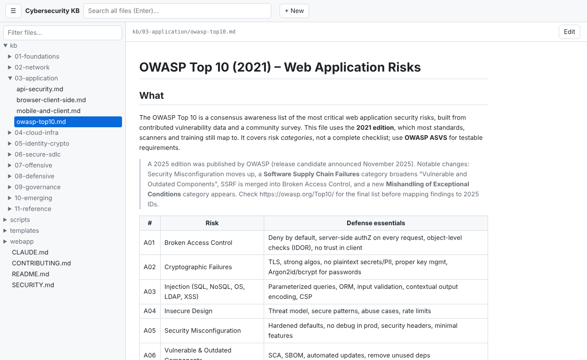

# Cybersecurity Knowledge Base

A practical, Claude-readable knowledge base covering the whole cybersecurity field, plus tooling to audit and harden your own software projects.

## ChatGPT and other reference knowledge bases

For security-related ChatGPT tasks, start with this repository's topic index below and the relevant full `kb/` pages. The [shared ChatGPT KB router](https://github.com/faheemkhaskheli9/AI-Knowledge-Base/blob/main/CHATGPT-KB-ROUTER.md) links the AI, software engineering, medical and security repositories and includes reusable Project instructions. For security reviews of AI systems, consult both this KB and the AI KB; for application architecture, add the software engineering KB. The router does **not** automatically grant repository access or synchronize content.

## Layout

| Path | Contents |
|------|----------|
| `CLAUDE.md` | Instructions Claude loads automatically in this repo (how to use the KB, how to secure projects) |
| `.claude/skills/secure-project-audit/` | Skill: audit any project against this KB and fix findings |
| `kb/01-foundations` | CIA triad, threat modeling, risk, attacker frameworks (ATT&CK, kill chain), zero trust |
| `kb/02-network` | Network defense, protocols, wireless, DNS, DDoS, email security |
| `kb/03-application` | OWASP Top 10, API security, GraphQL, WebSockets, file uploads, business logic and race conditions, mobile, browser/client side, browser extensions, HTTP request smuggling and web cache attacks |
| `kb/04-cloud-infra` | Cloud (incl. AWS/Azure/GCP baselines), serverless, SaaS tenants, databases, containers/Kubernetes, IaC, Linux/Windows hardening, firmware and boot security |
| `kb/05-identity-crypto` | IAM, authN/authZ, OAuth 2.0/OIDC, SAML, Active Directory, secrets, cryptography, PKI |
| `kb/06-secure-sdlc` | Secure SDLC, supply chain, SAST/DAST, CI/CD security, secure code review, memory safety, PSIRT and coordinated vulnerability disclosure |
| `kb/07-offensive` | Pentesting methodology, red team, bug bounty, exploit concepts (authorized testing only) |
| `kb/08-defensive` | SOC, detection engineering, incident response, cloud incident response, endpoint security and EDR, DFIR, malware analysis, threat intel, deception and honeytokens, insider threat |
| `kb/09-governance` | GRC, compliance (ISO 27001, SOC 2, NIST, PCI, GDPR), privacy, vulnerability management, third-party/vendor risk, data security and DLP, attack surface management |
| `kb/10-emerging` | AI/LLM security, IoT/OT, quantum, social engineering, physical |
| `kb/11-reference` | Glossary, tools, learning paths, cheat sheets |
| `templates/` | Drop-in `SECURITY.md`, Dependabot, CodeQL, gitleaks, pre-commit, CLAUDE security snippet |
| `scripts/` | `audit.sh` (quick local project audit), `bootstrap-project.sh` (install templates into a project), `sync-template-pins.sh` (copy workflow action pins into the templates) |

## KB file index

| Area | Files |
|------|-------|
| 01 Foundations | [core-concepts](kb/01-foundations/core-concepts.md) · [threat-modeling](kb/01-foundations/threat-modeling.md) · [frameworks-attack-models](kb/01-foundations/frameworks-attack-models.md) · [zero-trust-architecture](kb/01-foundations/zero-trust-architecture.md) |
| 02 Network | [network-security](kb/02-network/network-security.md) · [wireless-dns-ddos](kb/02-network/wireless-dns-ddos.md) · [email-security](kb/02-network/email-security.md) |
| 03 Application | [owasp-top10](kb/03-application/owasp-top10.md) · [api-security](kb/03-application/api-security.md) · [browser-client-side](kb/03-application/browser-client-side.md) · [mobile-and-client](kb/03-application/mobile-and-client.md) · [http-request-smuggling-and-cache-attacks](kb/03-application/http-request-smuggling-and-cache-attacks.md) · [graphql-security](kb/03-application/graphql-security.md) · [file-upload-security](kb/03-application/file-upload-security.md) · [business-logic-and-race-conditions](kb/03-application/business-logic-and-race-conditions.md) · [websocket-security](kb/03-application/websocket-security.md) · [browser-extension-security](kb/03-application/browser-extension-security.md) |
| 04 Cloud & infra | [cloud-security](kb/04-cloud-infra/cloud-security.md) · [containers-kubernetes-iac](kb/04-cloud-infra/containers-kubernetes-iac.md) · [os-hardening](kb/04-cloud-infra/os-hardening.md) · [cloud-provider-baselines](kb/04-cloud-infra/cloud-provider-baselines.md) · [database-security](kb/04-cloud-infra/database-security.md) · [saas-security](kb/04-cloud-infra/saas-security.md) · [serverless-security](kb/04-cloud-infra/serverless-security.md) · [firmware-and-boot-security](kb/04-cloud-infra/firmware-and-boot-security.md) |
| 05 Identity & crypto | [identity-access](kb/05-identity-crypto/identity-access.md) · [secrets-management](kb/05-identity-crypto/secrets-management.md) · [cryptography](kb/05-identity-crypto/cryptography.md) · [pki-and-tls](kb/05-identity-crypto/pki-and-tls.md) · [active-directory-security](kb/05-identity-crypto/active-directory-security.md) · [oauth-oidc-security](kb/05-identity-crypto/oauth-oidc-security.md) · [saml-security](kb/05-identity-crypto/saml-security.md) |
| 06 Secure SDLC | [secure-sdlc-and-supply-chain](kb/06-secure-sdlc/secure-sdlc-and-supply-chain.md) · [cicd-security](kb/06-secure-sdlc/cicd-security.md) · [secure-code-review](kb/06-secure-sdlc/secure-code-review.md) · [security-logging-and-monitoring](kb/06-secure-sdlc/security-logging-and-monitoring.md) · [memory-safety](kb/06-secure-sdlc/memory-safety.md) · [product-security-incident-response](kb/06-secure-sdlc/product-security-incident-response.md) |
| 07 Offensive | [pentest-methodology](kb/07-offensive/pentest-methodology.md) · [red-team-and-bug-bounty](kb/07-offensive/red-team-and-bug-bounty.md) |
| 08 Defensive | [soc-detection-ir](kb/08-defensive/soc-detection-ir.md) · [dfir-malware-threat-intel](kb/08-defensive/dfir-malware-threat-intel.md) · [ransomware-resilience](kb/08-defensive/ransomware-resilience.md) · [deception-and-honeytokens](kb/08-defensive/deception-and-honeytokens.md) · [insider-threat](kb/08-defensive/insider-threat.md) · [endpoint-security-and-edr](kb/08-defensive/endpoint-security-and-edr.md) · [cloud-incident-response](kb/08-defensive/cloud-incident-response.md) |
| 09 Governance | [grc-compliance-privacy](kb/09-governance/grc-compliance-privacy.md) · [vulnerability-management](kb/09-governance/vulnerability-management.md) · [third-party-risk-management](kb/09-governance/third-party-risk-management.md) · [data-security-and-dlp](kb/09-governance/data-security-and-dlp.md) · [attack-surface-management](kb/09-governance/attack-surface-management.md) |
| 10 Emerging | [ai-llm-security](kb/10-emerging/ai-llm-security.md) · [iot-ot-social-physical](kb/10-emerging/iot-ot-social-physical.md) · [post-quantum-cryptography](kb/10-emerging/post-quantum-cryptography.md) |
| 11 Reference | [glossary](kb/11-reference/glossary.md) · [tools-and-cheatsheets](kb/11-reference/tools-and-cheatsheets.md) · [learning-paths-and-resources](kb/11-reference/learning-paths-and-resources.md) |

## Practical workflows

- **Prioritize a vulnerability:** use [Vulnerability Management](kb/09-governance/vulnerability-management.md) to validate affected assets, weigh exploitation and business impact, and verify the fix.
- **Track a finding or exception:** copy the [finding and exception template](templates/vulnerability-finding.md) into your approved tracker. It includes ownership, deadlines, evidence and expiry.
- **Respond to suspected compromise:** start with [SOC, detection and incident response](kb/08-defensive/soc-detection-ir.md); patching alone is insufficient.

## Using it with Claude

**In this repo:** open Claude Code here; `CLAUDE.md` is loaded automatically.

**Secure another project (recommended):**
```bash
git clone <this-repo-url> ~/cybersec-kb
~/cybersec-kb/scripts/bootstrap-project.sh /path/to/your/project
```
This copies the security templates and adds an `@import` of the KB to the project's `CLAUDE.md`, so Claude follows your security rules in that project. Then ask Claude: *"Run the secure-project-audit skill on this project."*

**Install the skill globally:**
```bash
mkdir -p ~/.claude/skills && cp -r ~/cybersec-kb/.claude/skills/secure-project-audit ~/.claude/skills/
```

## Available in every new session
`scripts/install-global.sh` clones the three KB repos to `~/kb`, imports them from `~/.claude/CLAUDE.md` and installs their skills. Paste it into your cloud environment's **Setup script** (environment menu → Edit) so every new session runs it. The private repo needs GitHub access in that environment; otherwise it is skipped.

## Scope and ethics
Offensive content is for **authorized** testing, defense, CTFs and education. Never test systems you don't own or lack written permission to test. Never commit real secrets, client data or live exploit weaponization to this repo.

## Contributing
See [CONTRIBUTING.md](CONTRIBUTING.md). One topic per file, keep it actionable (what / why / how to defend / how to verify), link authoritative sources (OWASP, NIST, MITRE, CIS, vendor docs).

## Web app (view and edit)

```bash
python3 webapp/server.py --open     # http://localhost:8771 , stdlib only, no install
```

Browse, search, read rendered Markdown (with `[[wiki-links]]`) and edit the files in this repo from your browser.
Local only: it listens on 127.0.0.1, needs a per-run token for writes and refuses to overwrite files changed on disk.



Full guide with screenshots: [docs/app-guide.md](docs/app-guide.md)
