# Web app guide

The web app is a small local site for reading, searching and editing the files in this repository. It is
meant for the person who maintains the knowledge base, running on their own machine. It is not a site to
host for other people.


Use it when you want:
- the KB open next to code you are reviewing, with one search box over every file (for example "CSP",
  "IDOR", "SBOM");
- rendered Markdown with working `[[wiki-links]]` and relative links, which GitHub does not resolve for wiki-links;
- to fix or add a topic in place, then review the diff and commit with git.

Contents: [Start the app](#start-the-app) ·
[File tree and filter](#file-tree-and-filter) ·
[Reading a file](#reading-a-file) ·
[Links, wiki-links and frontmatter](#links-wiki-links-and-frontmatter) ·
[Full-text search](#full-text-search) ·
[Editing and saving](#editing-and-saving) ·
[Conflict detection](#conflict-detection) ·
[Creating a file](#creating-a-file) ·
[Sidebar toggle and small screens](#sidebar-toggle-and-small-screens) ·
[Dark mode](#dark-mode) ·
[Safety model](#safety-model) ·
[Configuration](#configuration) ·
[Tips, troubleshooting and limits](#tips-troubleshooting-and-limits) ·
[Command-line audit: scripts/audit.sh](#command-line-audit-scriptsauditsh)

## Start the app

Requirements: Python 3. The server uses only the standard library, so there is nothing to install.

```bash
python3 webapp/server.py            # serves http://localhost:8771/
python3 webapp/server.py --open     # same, and opens your browser
python3 webapp/server.py --port 9000
```

The terminal prints `Cybersecurity KB -> http://localhost:8771/  (Ctrl+C to stop)`. The default port
comes from `webapp/config.json`. Stop the server with Ctrl+C.

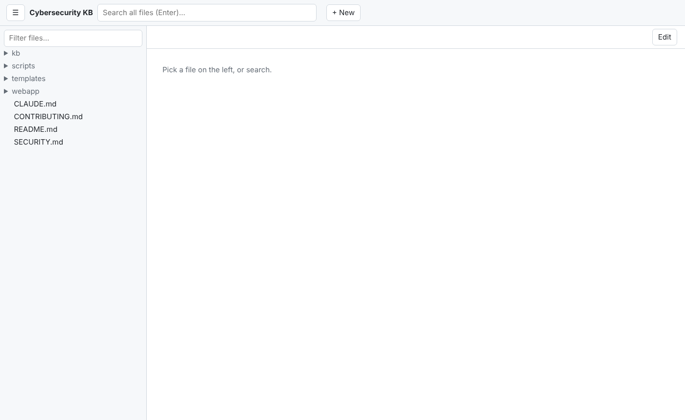

The start page shows the file tree on the left and "Pick a file on the left, or search." on the right.

## File tree and filter

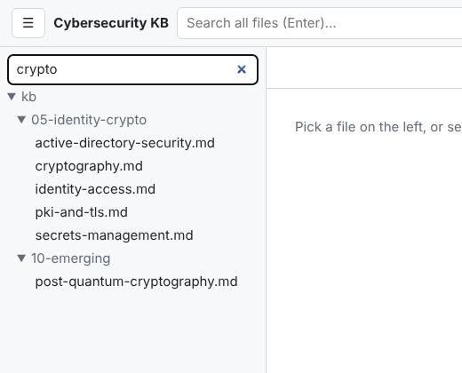

**What it does.** The left sidebar lists every viewable file in the repo as a folder tree. Folders start
collapsed; the folders of the file you open expand automatically and that file is highlighted.

**How to use it.**
1. Click a folder to expand it, then click a file to open it.
2. Type in **Filter files...** to keep only files whose path contains the text (case-insensitive). While
   a filter is active, all matching folders are expanded. Clear the box to see the full tree again.

**Which files appear.** Files ending in `.md`, `.txt`, `.csv`, `.json`, `.yml`, `.yaml`, `.toml`, `.py`
or `.sh`. Hidden files and folders (names starting with `.`, such as `.github` and `.claude`), symlinks,
and `node_modules`, `__pycache__`, `venv` and `.venv` are left out.

**Why.** The filter is the quickest way to jump to a topic when you know part of its name; use
[search](#full-text-search) when you only know what it says.

## Reading a file

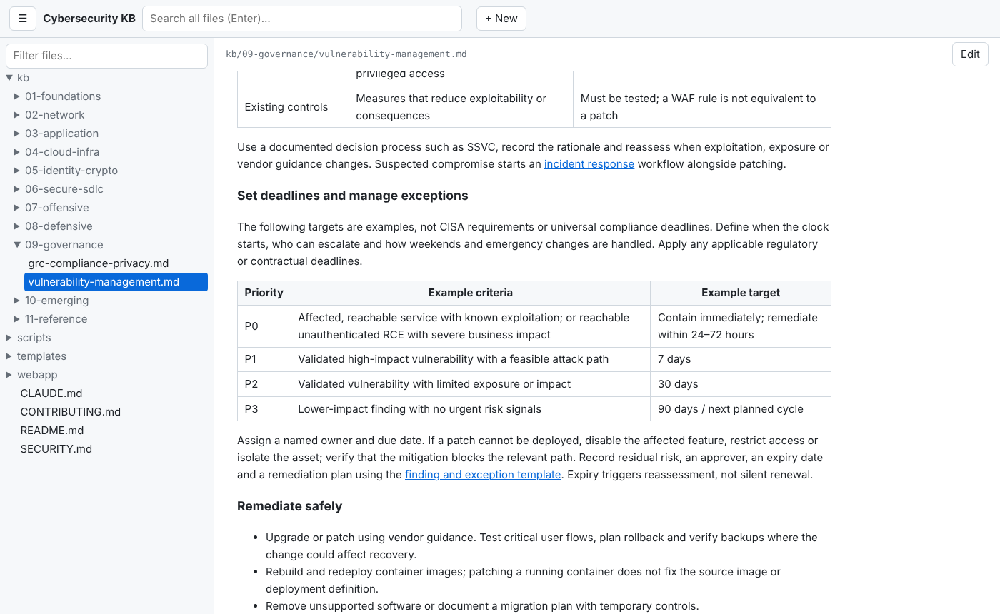

**What it does.** The selected file is shown on the right. The bar above it shows the file's path.

- `.md` files are rendered: headings, paragraphs, bold/italic/strikethrough, inline code, fenced code
  blocks, block quotes, horizontal rules, nested bulleted and numbered lists, task lists (shown as ☐/☑)
  and tables.
- `.csv` files are shown as a table.
- Everything else (`.py`, `.sh`, `.yml`, ...) is shown as plain text.

**Where/when.** The address bar changes to `#/<path>` (for example
`http://localhost:8771/#/kb/03-application/owasp-top10.md`), so you can bookmark a topic, share the link
with yourself, and use the browser's Back and Forward buttons.

**Why.** Reading rendered tables and lists is easier than reading raw Markdown, and the in-app links let
you follow a topic's references without leaving the page.

## Links, wiki-links and frontmatter

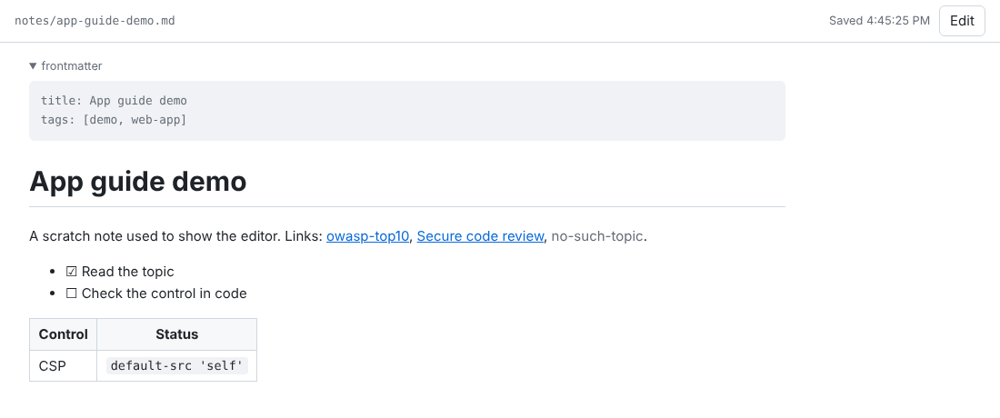

This screenshot uses a scratch note (deleted afterwards), because the KB topics do not use frontmatter
or wiki-links today.

- **Relative links** such as `[incident response](../08-defensive/soc-detection-ir.md)` open the target
  inside the app if that file is in the tree. A relative link to anything else (an image, a heading
  anchor like `#defenses`) is shown as plain text.
- **External links** (`http`, `https`, `mailto`) open in a new tab.
- **Wiki-links**: `[[owasp-top10]]` resolves by full path without `.md` first, then by file name alone.
  `[[kb/06-secure-sdlc/secure-code-review|Secure code review]]` shows the text after `|`. A wiki-link with
  no matching file is shown in grey (hover text "missing"), which makes broken links easy to spot.
- **Frontmatter**: a `---` block at the very top of a Markdown file is hidden behind a collapsed
  **frontmatter** line. Click it to see the raw YAML.

## Full-text search

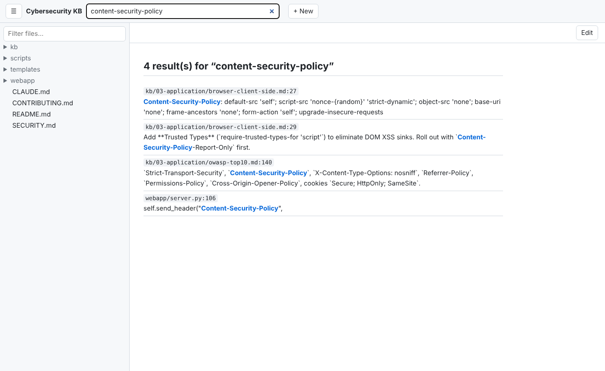

**What it does.** Searches the contents and names of every file in the tree.

**How to use it.**
1. Type at least 2 characters in **Search all files (Enter)...** in the header.
2. Press **Enter**.
3. Each result shows `path:line` and the matching line with the match highlighted. A file whose name
   matches is listed with `(filename)`. Click a result to open that file (it opens at the top, not at the
   line).

**Details.** Matching is a case-insensitive plain substring, not a regular expression or word search.
At most 200 results are returned. Result lines are shown as raw text (no Markdown formatting) and cut to
200 characters. Files over 2 MB or not valid UTF-8 are skipped.

**Why.** During a review you usually know the control or header name, not which topic covers it.

## Editing and saving

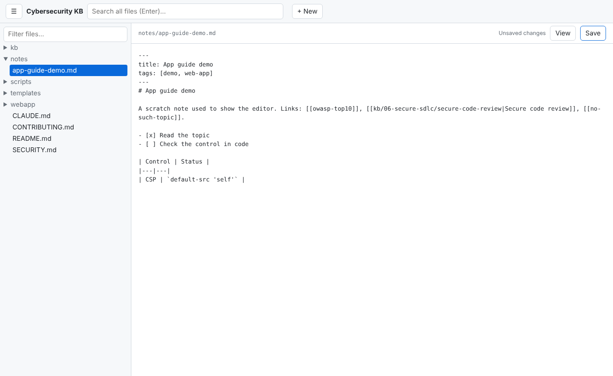

**How to use it.**
1. Open a file and click **Edit**. The rendered view is replaced by a plain-text editor and a **Save**
   button appears. The button now reads **View**.
2. Type. The status reads **Unsaved changes**.
3. Save with **Ctrl+S** (**Cmd+S** on macOS) or the **Save** button.
4. Click **View** to see the rendered result.


After a save the status shows **Saved** and the time. If you try to open another file with unsaved
changes, the app asks "Discard unsaved changes?"; closing or reloading the tab triggers the browser's
leave-page warning.

**What happens on disk.** The save writes straight to the file in your working copy: line endings are
converted to LF, the text is written as UTF-8, and the file is replaced in one step (written to a
temporary file, then renamed), keeping its permissions. Nothing is committed: review with `git diff` and
commit as usual.

**Why.** Small fixes (a typo, a new defense, a broken link) are faster to make where you read them. For
larger rewrites a normal editor is still the better tool.

## Conflict detection

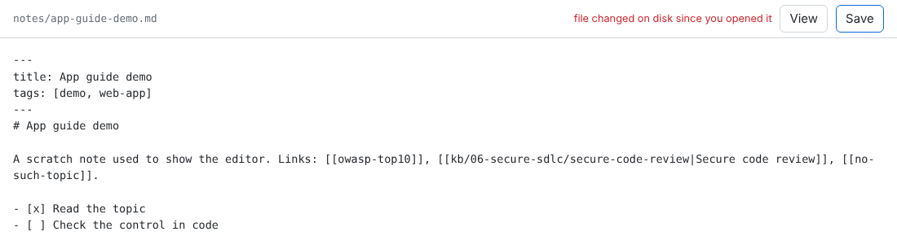

**What it does.** When you open a file the app remembers its modification time. If the file changes on
disk before you save (another editor, `git pull`, `git checkout`), the save is refused and the status shows
**file changed on disk since you opened it** in red. Your text stays in the editor; nothing is overwritten.

**What to do.** Copy your text out of the editor, reload the page (choose to leave when the browser warns
about unsaved changes), open the file again, reapply your change and save.

**Why.** It prevents the app from silently overwriting work done elsewhere.

## Creating a file

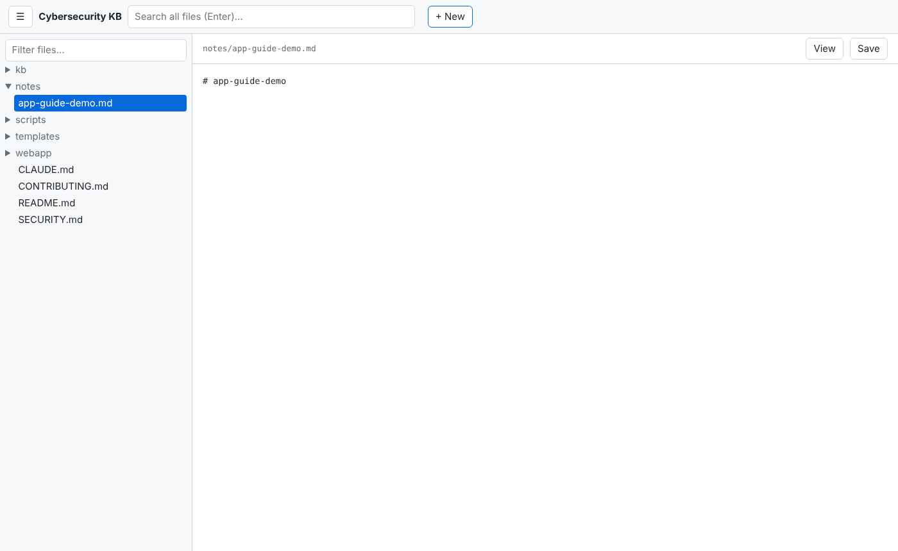

**How to use it.**
1. Click **+ New** in the header.
2. Enter a repo-relative path in the browser prompt, for example `kb/02-network/new-topic.md`.
3. The file is created (missing folders included), appears in the tree and opens in edit mode. A `.md`
   file starts with a `# <file name>` heading; other types start empty.

**Rules.** The path must end in one of the listed extensions and may not contain hidden (`.`) parts,
`..` or skipped folders. An existing file is never overwritten ("already exists"). Errors are shown in a
browser alert.

New KB topics should follow the section layout in [CONTRIBUTING.md](../CONTRIBUTING.md)
(What / Why it matters / Attacks / Defenses / How to verify / References); `scripts/check-kb.sh` checks it.

## Sidebar toggle and small screens

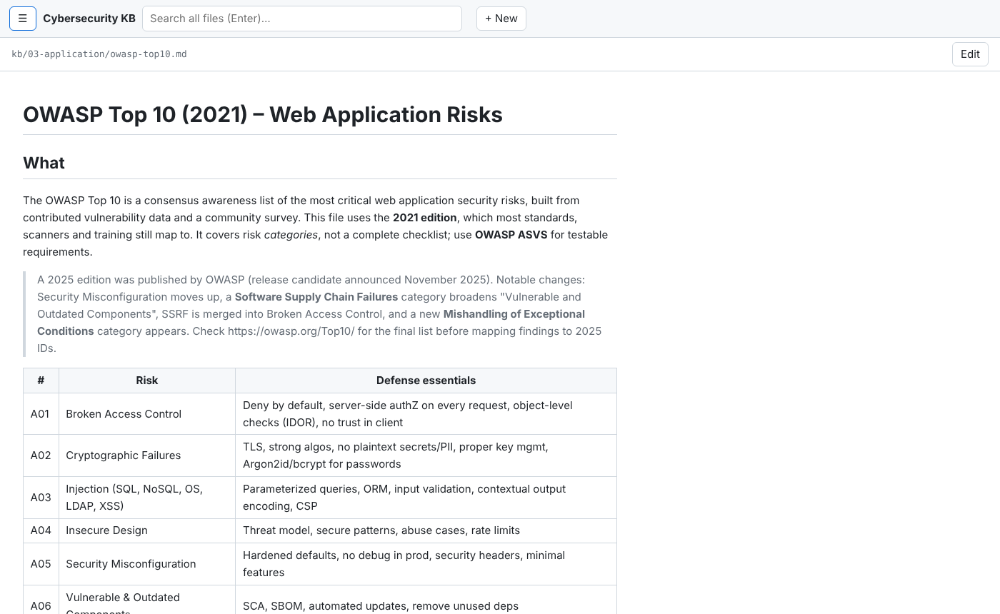

Click **☰** at the top left to hide or show the sidebar, giving the text the full width.

On a window 700 px wide or less, the sidebar opens over the page instead of beside it. Use **☰** to close
it and read.

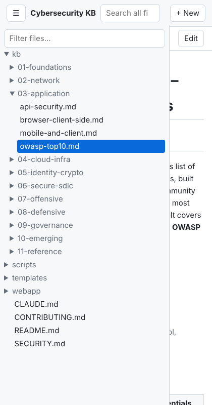

## Dark mode

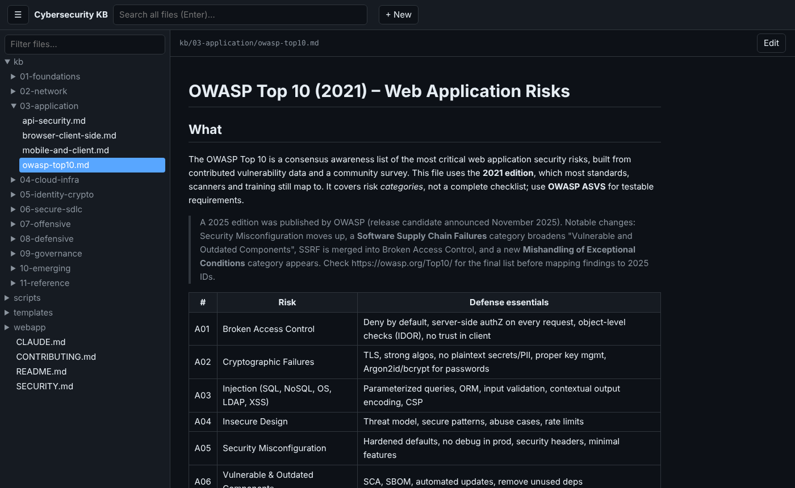

The app follows your operating system or browser colour-scheme setting. There is no separate switch in the
app.

## Safety model

The app can write to your repository, so it is locked down to your own machine:

- **Local only.** The server listens on `127.0.0.1`, so other machines on your network cannot reach it.
- **Host and Origin checks.** Requests whose `Host` is not `localhost`, `127.0.0.1` or `::1` are refused
  with "forbidden host" (this blocks DNS-rebinding attacks from web pages). A request whose `Origin` does not
  match the host is refused too.
- **Write token.** Every start generates a random token. The page fetches it on load and sends it with each
  save or create; without it, writes are refused with "bad token (reload the page)".
- **Path limits.** Only files with the listed extensions, inside the repo, outside hidden and skipped
  folders, can be read or written. Paths with `..`, absolute paths and backslashes are rejected. Files over
  2 MB cannot be opened or saved here.
- **Browser hardening.** Responses carry a strict Content-Security-Policy (only the app's own script and
  stylesheet), `X-Content-Type-Options: nosniff`, `Referrer-Policy: no-referrer` and `Cache-Control:
  no-store`. Markdown is rendered with raw HTML escaped, so a file cannot inject script into the page.
- **Conflict detection** (above) stops a save from overwriting a newer file.

## Configuration

`webapp/config.json` sets the title, default port, listed extensions and skipped folders. It also supports
two options that are empty in this repo:

- `"readonly": ["path/", "file.md"]` marks paths read-only: they show a 🔒 in the tree and "(read-only)"
  next to the path, and the server refuses to save them or create files under them.
- `"actions": {"Name": ["command", "arg"]}` adds a header button per entry. Clicking it runs that command
  in the repo root (2-minute timeout) and shows the exit code and the last 4000 characters of output in an
  alert.

Restart the server after changing the file.

## Tips, troubleshooting and limits

- **"bad token (reload the page)"**: the server was restarted since the page loaded. Reload the page.
- **"forbidden host"**: open the app as `http://localhost:8771/` or `http://127.0.0.1:8771/`, not through
  another host name.
- **Address already in use**: another program (or another copy of the app) uses the port. Start with
  `--port <other>`.
- **A file is missing from the tree**: check its extension and whether it sits in a hidden or skipped
  folder (see [File tree and filter](#file-tree-and-filter)).
- **The Edit button before a file is open**: it is shown on the start and search pages too, but does
  nothing useful there. Open a file first.
- **Images** in Markdown are not displayed; their alt text shows as plain text.
- **Headings have no anchors**, so `#heading` links are not followable inside the app.
- **No delete or rename.** Do these with git or your file manager; the tree updates when you reload the
  page.
- The tree is loaded once when the page opens. Reload to see files added outside the app.

## Command-line audit: `scripts/audit.sh`

The repo also ships a quick, heuristic security audit for your own projects. It has no web UI; it prints to
the terminal.

```bash
scripts/audit.sh /path/to/your/project      # defaults to the current folder
```

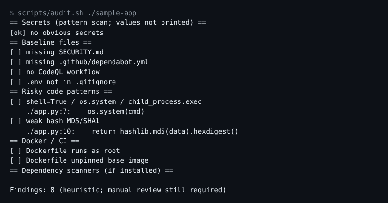

*Terminal output, captured from a real run against a throwaway sample project (a Python file using
`os.system` and `hashlib.md5`, and a Dockerfile on `python:latest` with no `USER`), rendered as an image.*

**What it checks.** Secret-like patterns (file names only, values are never printed) and sensitive files
tracked by git; baseline files (`SECURITY.md`, Dependabot, a CodeQL workflow, `.env` in `.gitignore`);
risky code patterns (`eval`/`exec`, shell execution, unsafe deserialization, MD5/SHA1, string-built SQL,
disabled TLS verification, `innerHTML`, `Math.random`); Dockerfile and GitHub Actions settings; and it runs
`npm audit`, `pip-audit`, `trivy` and `gitleaks` when they are installed.

**How to read it.** `[!]` lines are findings, `[ok]` lines passed, and the last line counts findings. It is
pattern matching, so expect false positives and misses (in the sample above, an f-string SQL query was not
flagged). It always exits 0, so it reports rather than fails a build. Use it as a first pass, then run the
`secure-project-audit` skill for a full review, and add missing baseline files with
`scripts/bootstrap-project.sh` (see the [README](../README.md)).
