# Web app guide

The web app is a small local site for reading, searching and editing the files in this repository. It is
meant for the person who maintains the knowledge base, running on their own machine. It is not a site to
host for other people.

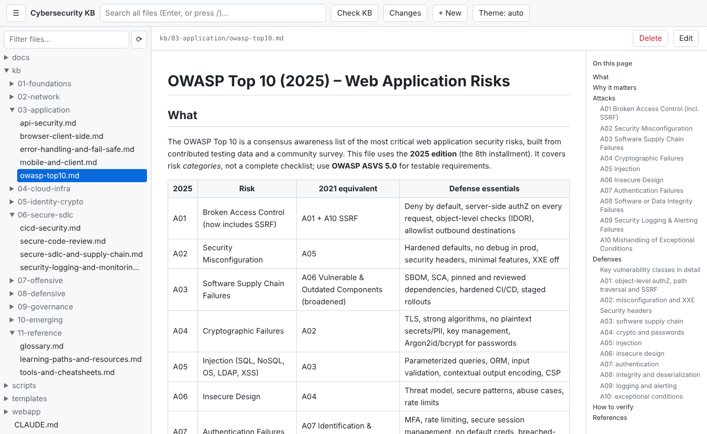

Use it when you want:
- the KB open next to code you are reviewing, with one search box over every file (for example "CSP",
  "IDOR", "SBOM");
- rendered Markdown with working links, heading links, an outline and the list of topics that link to the
  one you read;
- to fix or add a topic in place, preview it as you type, run the KB checks, review the diff and commit
  with git.

Contents: [Start the app](#start-the-app) · [File tree and filter](#file-tree-and-filter) ·
[Reading a file](#reading-a-file) · [Backlinks](#backlinks) · [Full-text search](#full-text-search) ·
[Editing with live preview](#editing-with-live-preview) · [Saving](#saving) · [Conflicts](#conflicts) ·
[Creating a file](#creating-a-file) · [Deleting a file](#deleting-a-file) ·
[Reviewing changes](#reviewing-changes) · [Header actions](#header-actions) ·
[Sidebar and small screens](#sidebar-and-small-screens) · [Theme](#theme) ·
[Keyboard shortcuts](#keyboard-shortcuts) · [Safety model](#safety-model) · [Configuration](#configuration) ·
[Refreshing these screenshots](#refreshing-these-screenshots) ·
[Tips, troubleshooting and limits](#tips-troubleshooting-and-limits) ·
[Command-line audit: scripts/audit.sh](#command-line-audit-scriptsauditsh)

## Start the app

Requirements: Python 3. The server uses only the standard library, so there is nothing to install.

```bash
python3 webapp/server.py            # serves http://localhost:8771/
python3 webapp/server.py --open     # same, and opens your browser
python3 webapp/server.py --port 9000
```

The terminal prints `Cybersecurity KB -> http://localhost:8771/  (Ctrl+C to stop)`. The default port comes from
`webapp/config.json`. Stop the server with Ctrl+C.


**Start page.** Shows how many files the app lists, the files you opened most recently in this browser
(up to 8, kept in the browser's local storage) and, inside a git checkout, how many files differ from the
last commit with a link to [review them](#reviewing-changes). Click the title at the top left to come back
to it.

## File tree and filter

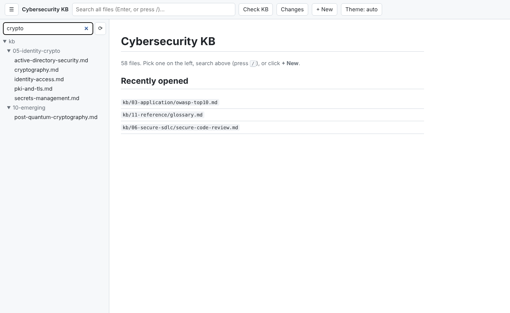

**What it does.** The left sidebar lists every viewable file as a folder tree. Folders start collapsed; the
folders of the file you open expand automatically and that file is highlighted.

**How to use it.**
1. Click a folder to expand it, then click a file to open it.
2. Type in **Filter files...** to keep only files whose path contains the text (case-insensitive, here
   `crypto`). All matching folders open. Clear the box to see the full tree again.
3. Click **⟳** to reload the tree after you add, rename or delete files outside the app.

**Which files appear.** Files ending in `.md`, `.txt`, `.csv`, `.json`, `.yml`, `.yaml`, `.toml`, `.py`, `.sh`. Hidden files and folders (names starting with `.`),
symlinks and the folders `node_modules`, `__pycache__`, `venv`, `.venv` are left out.

## Reading a file


**What it does.** The selected file is shown on the right; the bar above it shows its path.

- `.md` files are rendered: headings, paragraphs, bold/italic/strikethrough, inline code, fenced code
  blocks, block quotes, horizontal rules, nested lists, task lists (shown as ☐/☑) and tables.
- `.csv` files are shown as a table; everything else as plain text.
- The address bar changes to `#/<path>` (for example `http://localhost:8771/#/kb/03-application/owasp-top10.md`), so you can
  bookmark a file and use the browser's Back and Forward buttons.

**Outline.** A Markdown file with three or more headings gets an **On this page** list on the right (on
windows wider than 1100 px). Click an entry to jump to that section; the section flashes yellow.

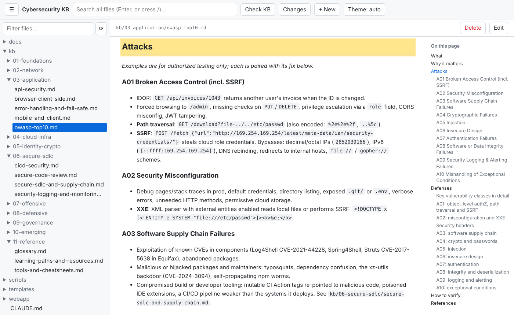

**Links.**
- Relative links such as `[x](../folder/topic.md)` open the target in the app. Links to a heading,
  `[x](topic.md#defenses)` or `[x](#defenses)`, jump to it: every heading gets a GitHub-style id (lower
  case, punctuation dropped, spaces as hyphens).
- `[[wiki-links]]` resolve by full path without `.md` first, then by file name alone. `[[name|text]]` shows
  `text`, and `[[name#heading]]` jumps to a heading. A wiki-link with no matching file is grey (hover text
  "missing"), so broken links are easy to spot.
- External links (`http`, `https`, `mailto`) open in a new tab.
- Images (``) are shown for PNG, JPEG, GIF and WebP files inside the repo. Remote
  images become links, because the page loads images only from the app itself. SVG is not shown.

**Frontmatter.** A `---` block at the top of a Markdown file is hidden behind a collapsed **frontmatter**
line. Click it to see the raw YAML.

## Backlinks

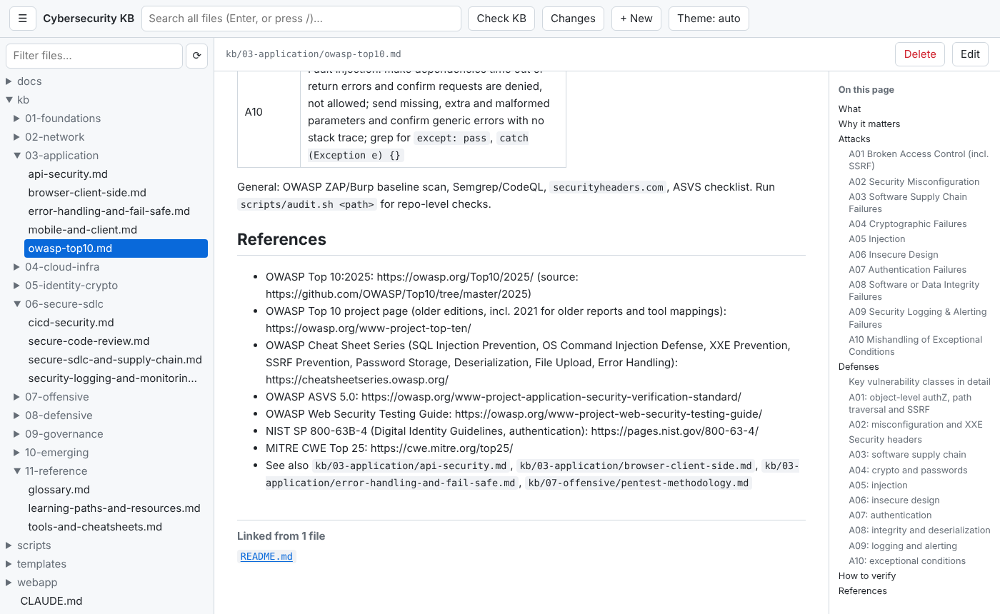

**What it does.** Below every Markdown file the app lists the other files that link to it, by
`[[wiki-link]]` or relative link. Each entry opens that file at the line holding the link. "No other file
links here" marks an orphan that readers following links can never reach: link it from a related topic.

## Full-text search


**How to use it.**
1. Click the search box (or press **/** anywhere outside a text field) and type at least 2 characters.
2. Press **Enter**. The address bar changes to `#search=<text>`, so Back returns to the results.
3. Each result shows `path:line` and the matching line with the match highlighted; a file whose name
   matches is listed as `(filename)`. Click a result to open the file at that line: the view scrolls to the
   block holding it and flashes it, and **Edit** puts the cursor on that line.

**Details.** Matching is a case-insensitive plain substring, not a regular expression. At most 200 results
are returned; files over 2 MB or not valid UTF-8 are skipped.

## Editing with live preview

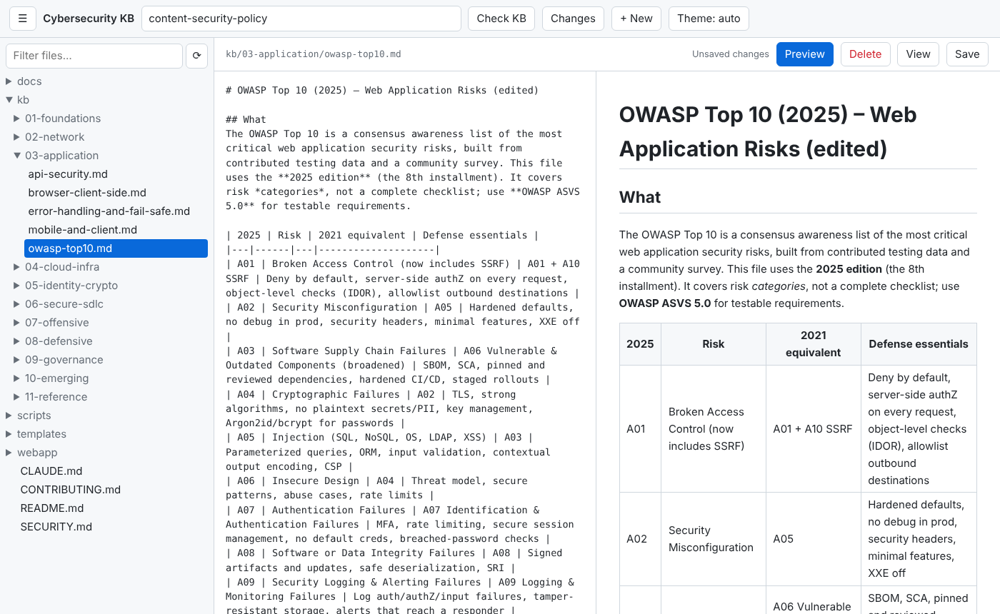

**How to use it.**
1. Open a file and click **Edit**. The rendered view is replaced by a plain-text editor, and **Save**
   and **Preview** appear. The button now reads **View**.
2. Click **Preview** (Markdown and CSV files) to show the rendered result beside the editor. It updates as
   you type; click again to hide it. The setting lasts until you reload the page.
3. Click **View** to see the rendered text, saved or not. Unsaved edits stay; the status still reads
   **Unsaved changes**.

On a window 700 px wide or less the preview is hidden; use **View** instead.

## Saving


Save with **Ctrl+S** (**Cmd+S** on macOS) or the **Save** button. The status shows **Saved** and the time.
If you try to leave the file with unsaved changes, the app asks "Discard unsaved changes?"; closing or
reloading the tab triggers the browser's leave-page warning.

**What happens on disk.** Line endings become LF, the text is written as UTF-8, and the file is replaced in
one step (temporary file, then rename), keeping its permissions. Nothing is committed: review your edits on
the [Changes](#reviewing-changes) page or with `git diff`, then commit with git.

## Conflicts


**What it does.** The app remembers each file's modification time when it opens it. If the file changed on
disk before you save (another editor, `git pull`, a second browser tab), the save is refused, nothing is
written, and the bar shows **file changed on disk since you opened it** with two buttons:

- **Load disk version** drops your edits and opens the file as it is on disk now.
- **Overwrite** saves your text over the newer file (after a confirmation). Use it only when you know the
  other change can go; otherwise copy your text out first, load the disk version and re-apply your edit.

## Creating a file


1. Click **+ New** in the header.
2. Enter a repo-relative path, for example `folder/new-topic.md`.
3. The file is created (missing folders too), appears in the tree and opens in the editor.

A new `.md` file starts as a copy of `templates/kb-topic.md`, with `YYYY-MM-DD` set to today and, where the template
has a `category: <...>` line, the category set to the first folder of the path. Fill in every section, then
run the repo's checks. Other file types start empty.

**Rules.** The path must end in one of the listed extensions and may not contain hidden (`.`) parts, `..`
or skipped folders. An existing file is never overwritten ("already exists").

## Deleting a file

Open the file and click **Delete** in the bar, then confirm. The file is removed from disk and the app goes
back to the start page. A file that was committed can be restored with `git restore <path>`; a file that was
never committed cannot be recovered. Read-only files have no **Delete** button, and a file that changed on
disk since you opened it is not deleted.

## Reviewing changes

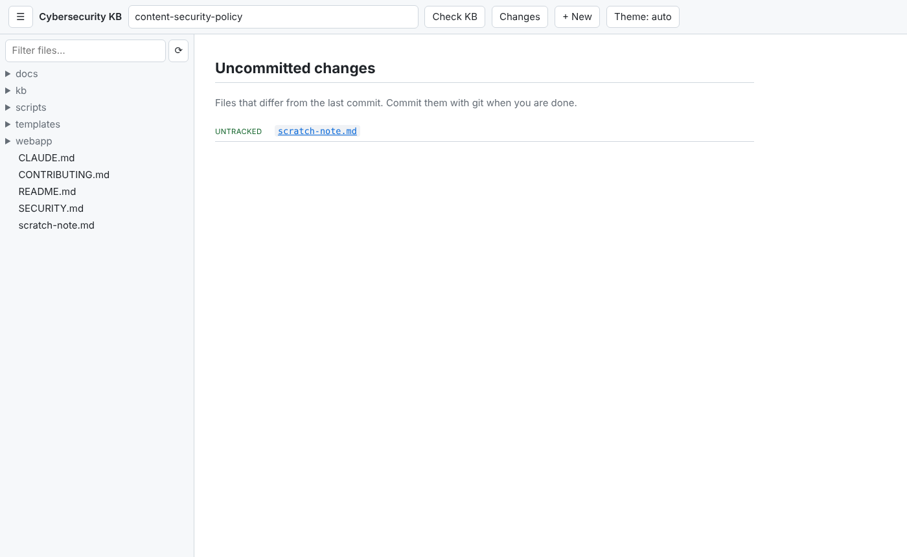

**What it does.** Inside a git checkout the header has a **Changes** button. It lists every file that
differs from the last commit (`git status`), marked modified, added, deleted, renamed or untracked.

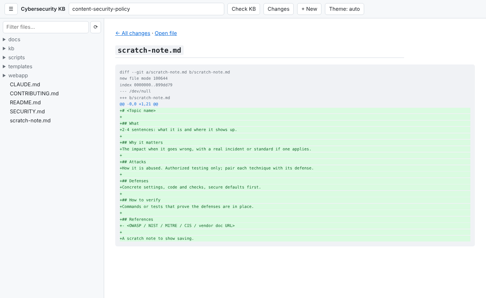

Click a file to see its diff against the last commit: added lines in green, removed lines in red. **Open
file** jumps to the file, **All changes** goes back. Use it before you commit to check what you edited in the
app. Only the file types the tree shows are linked; diffs over 256 KB are cut. The page is read-only: stage
and commit with git.

## Header actions

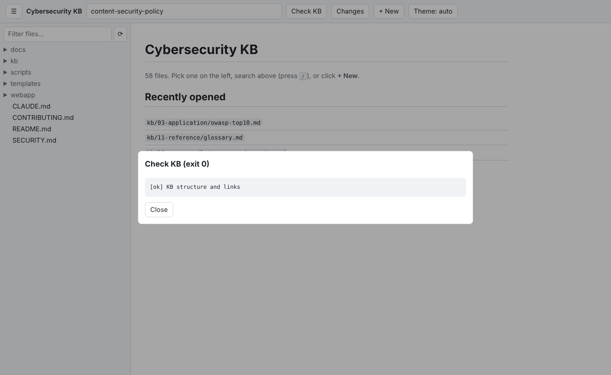

- **Check KB** runs `bash scripts/check-kb.sh`.

Click a button to run its command in the repo root (2-minute limit). A window shows the exit code and the
last 4000 characters of output; close it with **Close** or Esc. The tree reloads afterwards, and the open file
reloads if it has no unsaved edits, so regenerated files show their new content.

Use **Check KB** after adding or editing a topic: it runs the same structure, link, README-index, encoding and Action-pin checks as CI and names each problem with `[x] file: ...`. New topics follow the layout in [CONTRIBUTING.md](../CONTRIBUTING.md) (What / Why it matters / Attacks / Defenses / How to verify / References), which **+ New** starts from via `templates/kb-topic.md`.

## Sidebar and small screens


Click **☰** to hide or show the sidebar and give wide tables the full width.

On a window 700 px wide or less the sidebar opens over the page: the app starts with it closed, and it
closes again when you pick a file. The header wraps and the search box takes its own row.

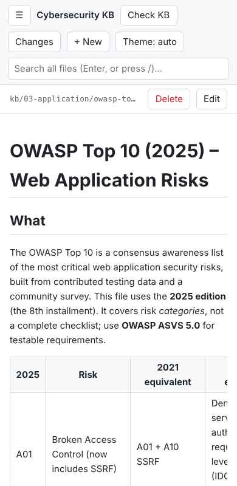 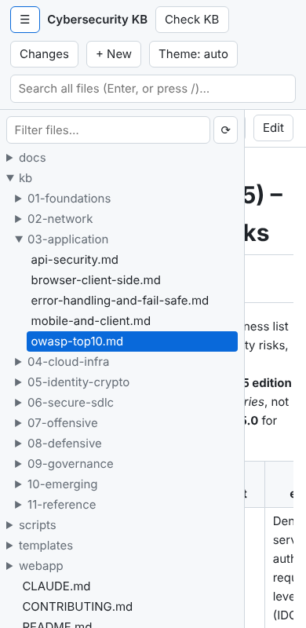

## Theme

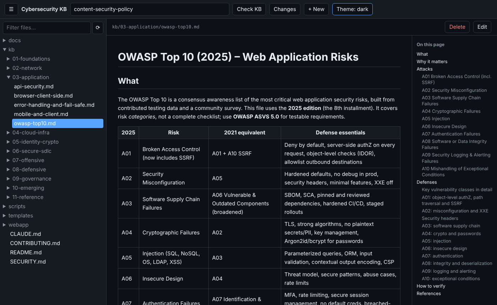

The **Theme** button cycles through **auto** (follow the operating system or browser setting), **light** and
**dark**. The choice is kept in this browser.

## Keyboard shortcuts

| Key | Does |
|---|---|
| **/** | Focus the search box (outside text fields) |
| **Enter** in the search box | Search |
| **Ctrl+S** / **Cmd+S** | Save |
| **Esc** | Close the action output window |

## Safety model

The app can write to your repository, so it is locked down to your own machine:

- **Local only.** The server listens on `127.0.0.1`; other machines cannot reach it.
- **Host and Origin checks.** Requests whose `Host` is not `localhost`, `127.0.0.1` or `::1` are refused with
  "forbidden host" (this blocks DNS-rebinding attacks from web pages); so is a request whose `Origin` does
  not match the host.
- **Write token.** Every start generates a random token. The page fetches it on load and sends it with each
  save, create, delete and action; without it, writes are refused with "bad token (reload the page)".
- **Path limits.** Only files with the listed extensions, inside the repo, outside hidden and skipped
  folders, can be read, written or deleted. Paths with `..`, absolute paths and backslashes are rejected.
  Files over 2 MB cannot be opened or saved here.
- **Read-only routes.** Images (PNG, JPEG, GIF, WebP up to 10 MB, checked by extension and content),
  backlinks, the change list and diffs only read. Git runs with fixed arguments, never a shell.
- **Browser hardening.** Responses carry a strict Content-Security-Policy (only the app's own script and
  stylesheet), `X-Content-Type-Options: nosniff`, `Referrer-Policy: no-referrer` and `Cache-Control:
  no-store`. Markdown is rendered with raw HTML escaped, so a file cannot inject script into the page.
- **Conflict checks** stop a save or delete from overwriting a newer file.

## Configuration

`webapp/config.json`:

| Key | Meaning |
|---|---|
| `title`, `port` | Page title and default port |
| `extensions`, `skip_dirs` | Which files the tree lists and which folders it skips |
| `readonly` | Paths shown with 🔒 that cannot be saved, deleted or created under, e.g. `["generated/", "INDEX.md"]` |
| `template` | File a new `.md` file starts from (here `templates/kb-topic.md`) |
| `actions` | Header buttons: `{"Name": ["command", "arg"]}`, run in the repo root |
| `screenshots` | Settings for `webapp/screenshots.mjs` (below) |

Restart the server after changing it.

## Refreshing these screenshots

The screenshots in this guide come from the real app. To regenerate them after a change, commit your work
first (the Changes shots list every uncommitted file), then:

```bash
npm install -g playwright && npx playwright install chromium   # once
node webapp/screenshots.mjs                                     # writes docs/screenshots/*.png
SHOTS_OUT=/tmp/shots node webapp/screenshots.mjs                # trial run elsewhere
```

It starts the server on a free port, opens `kb/03-application/owasp-top10.md` and the other pages named under `screenshots` in
`config.json`, creates and deletes a scratch file `scratch-note.md`, and runs the first header action.

## Tips, troubleshooting and limits

- **"bad token (reload the page)"**: the server was restarted since the page loaded. Reload the page.
- **"forbidden host"**: open the app as `http://localhost:8771/` or `http://127.0.0.1:8771/`.
- **Address already in use**: another program uses the port. Start with `--port <other>`.
- **A file is missing from the tree**: check its extension and folder (see
  [File tree and filter](#file-tree-and-filter)), then click **⟳**.
- **No Changes button**: the folder is not a git checkout, or `git` is not installed.
- **No rename.** Rename with git (`git mv`) or your file manager, then click **⟳**.
- Backlinks and search read every file on each request; on a very large repo they take a moment.

## Command-line audit: `scripts/audit.sh`

The repo also ships a quick, heuristic security audit for your own projects. It has no web UI; it prints to
the terminal.

```bash
scripts/audit.sh /path/to/your/project            # defaults to the current folder
scripts/audit.sh --strict /path/to/your/project   # exit 1 when there are findings (CI gate)
```


*Terminal output, captured from a real run against a throwaway sample project (a Python file using
`os.system`, an f-string SQL query and `hashlib.md5`, and a Dockerfile on `python:latest` with no `USER`),
rendered as an image.*

**What it checks.** Secret-like patterns (file names only, values are never printed) and sensitive files
tracked by git; baseline files (`SECURITY.md`, Dependabot, a CodeQL workflow, `.env` in `.gitignore`);
risky code patterns (`eval`/`exec`, shell execution, unsafe deserialization, MD5/SHA1, string-built SQL,
disabled TLS verification, `innerHTML`, `Math.random`); Dockerfile settings; GitHub Actions pinned to tags
instead of commit SHAs and `${{ github.event... }}` used inside `run:` scripts; and it runs `npm audit`,
`pip-audit`, `osv-scanner`, `trivy` and `gitleaks` when they are installed. Mark a deliberate secret-like
test value with a `gitleaks:allow` comment to suppress it.

**How to read it.** `[!]` lines are findings, `[ok]` lines passed, and the last line counts findings. It is
pattern matching, so expect false positives and misses. It exits 0 unless you pass `--strict`, so by
default it reports rather than fails a build. Use it as a first pass, then run the
`secure-project-audit` skill for a full review, and add missing baseline files with
`scripts/bootstrap-project.sh` (see the [README](../README.md)).
